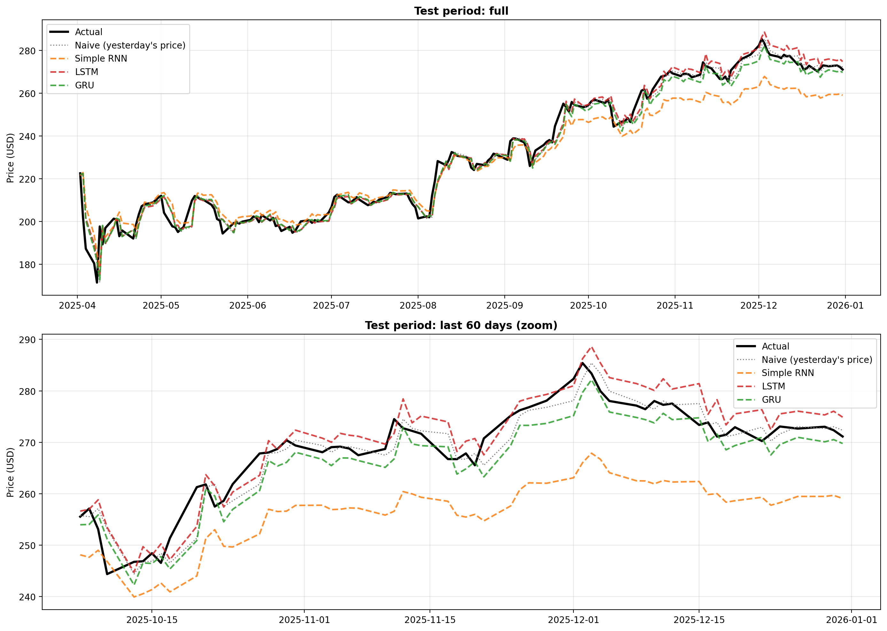
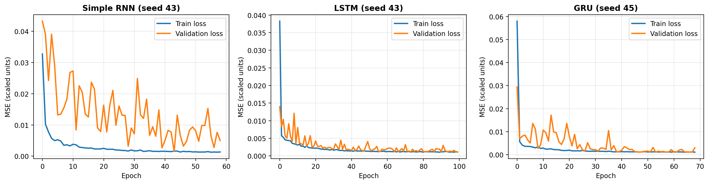
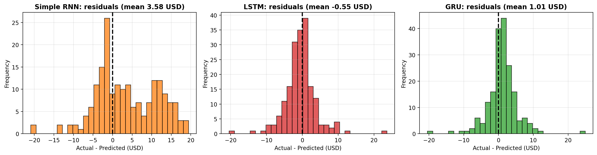
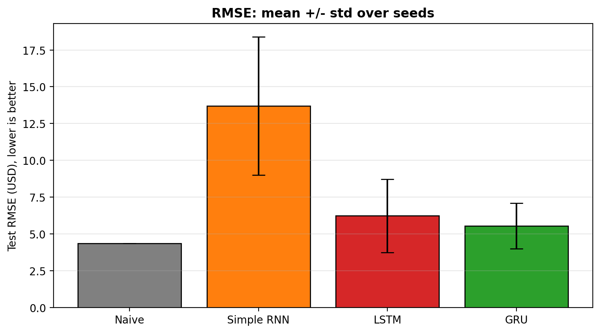

# BIFS: RNN vs LSTM vs GRU for Stock Price Forecasting

One-day-ahead forecasting of a stock's closing price (default: AAPL, 2021-2026) with three
recurrent networks (**Simple RNN, LSTM, GRU**), evaluated against a naive baseline.
This repository is the model-comparison core of the Business Insight Forecasting System (BIFS).
MPhil Mathematics project.

## Problem
Given the previous 15 closing prices, predict the next day's close.

## Method
1. Download adjusted Close prices from Yahoo Finance (cached in `data/` for reproducibility).
2. Chronological split: 70 % train, 15 % validation, 15 % test (no shuffling across time).
3. Scale with the **training period only**: x' = (x - x_min) / (x_max - x_min).
4. Sliding windows of 15 days, split by *target day* (no days lost, no future data in inputs).
5. Three identical architectures (2 x recurrent(50) + Dropout 0.2 + Dense(25, ReLU) + Dense(1));
   only the cell differs. Adam, MSE loss, early stopping on validation loss (patience 15).
6. Repeat for 5 random seeds; report mean +/- std on the test set, in **USD**.
7. Compare with the **naive baseline** "tomorrow = today".

Optional `target_mode="return"` predicts log-returns and rebuilds the price as
P_t = P_(t-1) * exp(r_t), which removes the out-of-range problem of scaled prices in a trending market.

## Metrics
RMSE, MAE, MAPE, R2, directional accuracy, and **skill vs naive** = 1 - RMSE_model / RMSE_naive.

## Results
Test period: 189 trading days (AAPL, adjusted close, USD). Mean +/- std over 5 seeds (price mode).

| Model | RMSE (USD) | MAE (USD) | MAPE (%) | R2 | Dir. acc. (%) | Skill vs naive |
|---|---|---|---|---|---|---|
| **Naive** (yesterday's price) | **4.343** | 2.727 | 1.24 | 0.9789 | n/a | 0 % |
| GRU | 5.535 +/- 1.542 | 3.956 +/- 1.498 | 1.75 +/- 0.62 | 0.9636 +/- 0.0202 | 49.9 +/- 4.3 | -27.4 % |
| LSTM | 6.226 +/- 2.485 | 4.549 +/- 2.267 | 2.00 +/- 0.94 | 0.9512 +/- 0.0414 | 49.6 +/- 4.5 | -43.4 % |
| Simple RNN | 13.685 +/- 4.701 | 10.613 +/- 3.516 | 4.26 +/- 1.36 | 0.7709 +/- 0.1636 | 47.2 +/- 1.2 | -215.1 % |

**Key findings**
* The naive persistence baseline had the lowest error; no recurrent model beat it.
* Simple RNN was worse than both LSTM and GRU in all 5 seeds (consistent with vanishing gradients).
* GRU was best among the neural models, but GRU vs LSTM is not conclusive (GRU better in 3 of 5 seeds; the gap is smaller than seed-to-seed variation).
* Directional accuracy was about 50 %, i.e. no reliable up/down skill.
* Conclusion: for one-day-ahead price forecasting, persistence is a very strong baseline, which is why baselines and multi-seed evaluation are essential.






## How to run
**Google Colab:** upload `BIFS_RNN_LSTM_GRU_Comparison.ipynb` (File > Upload notebook) and Run all.

**Local:**
```bash
pip install -r requirements.txt
python bifs_rnn_lstm_gru_comparison.py
```
Change settings (ticker, dates, look-back, seeds, `target_mode`) in the `Config` dataclass.

## Dashboard (Streamlit)
After running the experiment (so `results/` exists):
```bash
streamlit run app.py
```
Tabs: **Forecast** (next-day forecast from each model), **Backtest** (interactive test-period chart and metrics),
**Model comparison** (mean +/- std table, skill vs naive), **Risk** (historical VaR and Expected Shortfall).
To deploy free: push the repo (including `results/models/`) and deploy `app.py` on Streamlit Community Cloud.

## Outputs
`results/models/*.keras` (best seed per model, chosen by validation loss), `results/models/scaler.joblib`,
`results/metrics_per_seed.csv`, `results/metrics_summary.csv`, `results/config.json`, and the figures.

## What was corrected from the first version
| Issue in the original code | Fix |
|---|---|
| Scaler fitted on all data (test information leaked into training) | Scaler fitted on the training period only |
| No validation set; fixed 10 epochs | Train/val/test split, early stopping on validation loss |
| RNN, LSTM and GRU had different architectures | One shared architecture, only the cell type changes |
| Metrics computed on 0-1 scaled values (RMSE/MAE not in USD, MAPE distorted) | All metrics computed on real USD prices |
| No baseline | Naive "yesterday's price" baseline and skill score |
| Single run, one random seed | 5 seeds, mean +/- std; best model chosen by validation loss, never by test |
| First 15 days of validation/test windows were thrown away | Windows built by target day across split boundaries |
| Test prices outside the training range (scaled > 1) | Optional log-return mode |
| Duplicated code, 3 near-identical files, empty README | One script + one notebook, functions, documented README |
| Colab file reinstalled TensorFlow/Keras and opened `.py` as a notebook | Proper `.ipynb`, installs only `yfinance` |
| Live re-download each run (data could change) | Data cached to CSV |

## Limitations
* One stock, closing price only (univariate); results may not generalise.
* Price level forecasts are dominated by persistence (today's price is a strong predictor of tomorrow's);
  this is why the naive baseline matters.
* Accuracy of a forecast is not the same as trading profitability. Not financial advice.
* Bitwise reproducibility is not guaranteed across hardware, hence the multi-seed reporting.

## Possible extensions
Multi-feature input (Open/High/Low/Volume, returns, indicators), multi-day horizons, more tickers,
walk-forward validation, Diebold-Mariano test, Streamlit dashboard with risk measures (VaR / Expected Shortfall).
